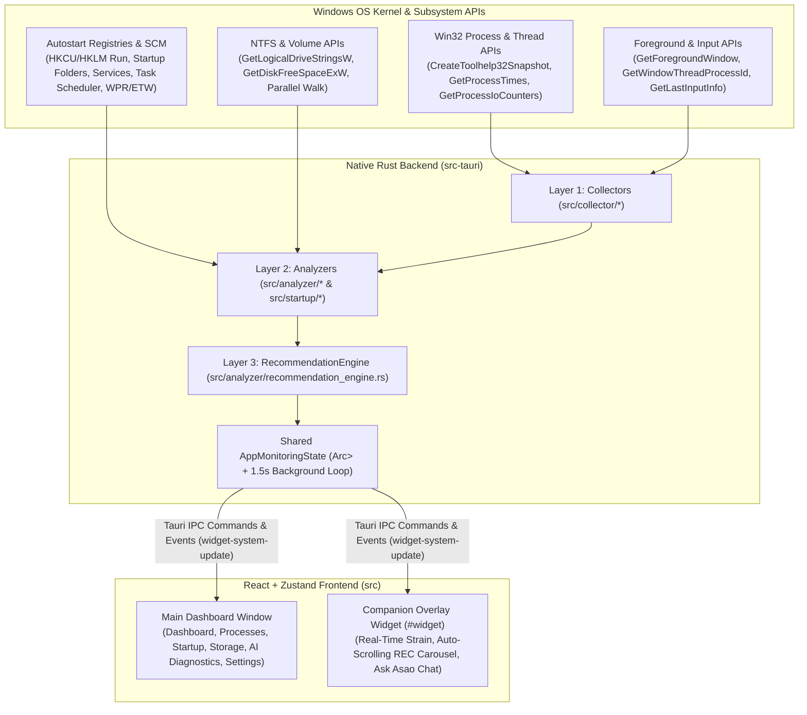
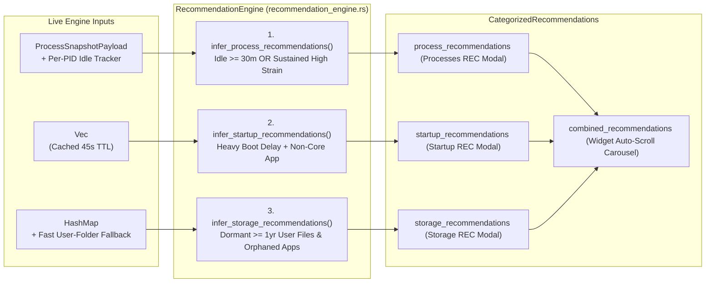

# ASAO Technical Architecture, Rust Telemetry Pipeline & Recommendation Engine

This document provides an end-to-end architectural and mathematical reference for **ASAO**:
1. **How the Native Rust Backend Collects Processes, Startup, and Storage Telemetry**
2. **How the Multi-Domain Recommendation Engine (`RecommendationEngine`) Works & Exact Mathematical Formulas**
3. **End-to-End Feature Workflows (Processes, Startup, Storage, Companion Widget, and AI Diagnostics)**
4. **Complete Codebase Directory & Module Structure (`src-tauri/` and `src/`)**

---

## 1. System Architecture Overview

ASAO is built as a **dual-window Tauri v2 desktop application** pairing a **multi-threaded Win32/Rust telemetry & inference engine** (`src-tauri`) with a **React 19 + TypeScript + Zustand frontend** (`src`).



---

## 2. How Rust Fetches & Analyzes System Data

### 2.1 Processes & Real-Time System Telemetry

 Process collection and analysis is split across **Layer 1 Collectors** ([`src-tauri/src/collector/`](file:///c:/Coding%20Files/ASAO/src-tauri/src/collector/mod.rs)) and **Layer 2 Analyzers** ([`src-tauri/src/analyzer/process_analyzer.rs`](file:///c:/Coding%20Files/ASAO/src-tauri/src/analyzer/process_analyzer.rs)):

1. **System-Wide CPU & Memory Sampling** ([`cpu.rs`](file:///c:/Coding%20Files/ASAO/src-tauri/src/collector/cpu.rs), [`memory.rs`](file:///c:/Coding%20Files/ASAO/src-tauri/src/collector/memory.rs)):
   - Calls `GetSystemTimes` (`idleTime`, `kernelTime`, `userTime` in 100-nanosecond kernel ticks) to compute the exact system CPU delta between samples:
     $$\text{CPU}_{\text{sys}} = \left(1.0 - \frac{\Delta \text{Idle}_{100\text{ns}}}{\Delta \text{Kernel}_{100\text{ns}} + \Delta \text{User}_{100\text{ns}}}\right) \times 100$$
   - Calls `GlobalMemoryStatusEx` to read physical RAM `ullTotalPhys`, `ullAvailPhys`, and compute exact used bytes and percentage.

2. **Per-Process Kernel & I/O Counters** ([`processes.rs`](file:///c:/Coding%20Files/ASAO/src-tauri/src/collector/processes.rs)):
   - Enumerates running PIDs and opens each process with `PROCESS_QUERY_LIMITED_INFORMATION | PROCESS_VM_READ`.
   - Reads `GetProcessTimes` (kernel + user 100ns ticks), `GetProcessMemoryInfo` (`WorkingSetSize` / private resident memory), and `GetProcessIoCounters` (`ReadTransferCount`, `WriteTransferCount`, `OtherTransferCount`).
   - Extracts Win32 PE Version Info metadata (`CompanyName` / Publisher, `ProductName`, `FileDescription`) and caches it by executable path so binary metadata is parsed only once.

3. **Foreground Window & User Idle Tracking** ([`activity.rs`](file:///c:/Coding%20Files/ASAO/src-tauri/src/collector/activity.rs)):
   - Calls `GetForegroundWindow` and `GetWindowThreadProcessId` to detect the exact process (`foreground_pid`) currently focused by the user.
   - Tracks `last_foreground_seen: HashMap<u32, Instant>` for every PID. Furthermore, child processes (`parent_pid == foreground_pid`) and sibling processes with the same executable name (e.g., multi-process browser tabs or IDE workers) are grouped into `is_foreground_family`.
   - Calls `GetLastInputInfo` to measure keyboard/mouse idle time and determine `is_user_active`.

4. **Per-Process Delta & Rolling Sustained Window** ([`process_analyzer.rs`](file:///c:/Coding%20Files/ASAO/src-tauri/src/analyzer/process_analyzer.rs)):
   - `ProcessAnalyzerEngine` maintains a `pid_states: HashMap<u32, PidSampleState>` across ticks.
   - Computes per-PID instantaneous CPU percentage from the ratio of the process's 100ns CPU tick delta to the total system CPU tick delta:
     $$\text{CPU}_{\text{pid}} = \left(\frac{\Delta \text{ProcTicks}_{100\text{ns}}}{\Delta \text{SysTotalTicks}_{100\text{ns}}}\right) \times 100$$
   - Maintains a 6-sample rolling deque (`recent_cpu_samples`) to compute **`sustained_cpu_percent`** (filtering out harmless 1-second spikes) and increments **`sustained_load_seconds`** whenever a process continuously consumes $\ge 2.5\%$ CPU or $\ge 350\text{ MB}$ RAM.

---

### 2.2 Startup Applications & Boot Impact Discovery

Startup enumeration is handled by [`src-tauri/src/startup/scanner.rs`](file:///c:/Coding%20Files/ASAO/src-tauri/src/startup/scanner.rs) (`scan_all_startup_items`):

1. **Six Windows Autostart Sources**:
   - **Registry Run / RunOnce Keys**: Inspects `HKCU\Software\Microsoft\Windows\CurrentVersion\Run`, `RunOnce`, `HKLM\...\Run`, `RunOnce`, and `WOW6432Node` 32-bit equivalents. Also reads `StartupApproved\Run` and `StartupApproved\StartupFolder` binary flags to determine whether an item is currently enabled or disabled by Windows Task Manager.
   - **Shell Startup Folders**: Scans both `%APPDATA%\Microsoft\Windows\Start Menu\Programs\Startup` (per-user) and `%ProgramData%\Microsoft\Windows\Start Menu\Programs\StartUp` (all-users), resolving `.lnk` shortcuts to their target executables.
   - **Windows Services**: Queries the Service Control Manager (SCM) for non-Microsoft services configured with `SERVICE_AUTO_START` (Automatic or Delayed-Automatic).
   - **Scheduled Tasks**: Enumerates Windows Task Scheduler entries configured with `BootTrigger` or `LogonTrigger`.
   - **Winlogon & Boot Policies**: Inspects `HKLM\...\Winlogon` (`Shell`, `Userinit`), `AppInit_DLLs`, `BootExecute`, and Explorer `Policies\Explorer\Run`.

2. **Live Process Correlation & Boot Impact Estimation**:
   - Cross-references every discovered startup entry against the live `ProcessInfo` snapshot (matching executable path or stem) to populate `is_currently_running`, `pid`, live `memory_bytes`, and publisher metadata.
   - Integrates with **Windows Performance Recorder (`wpr.exe`) / ETW boot traces** when available (`etw_traced`), or estimates `boot_cpu_ms`, `boot_disk_bytes`, and `boot_duration_ms` from binary footprint, I/O characteristics, and live memory working set:
     - **High Impact (`StartupImpact::High`)**: `boot_duration_ms >= 2000` ms or `boot_cpu_ms >= 1000` ms or `memory_bytes >= 300 MB`.
     - **Medium Impact (`StartupImpact::Medium`)**: `boot_duration_ms >= 750` ms or `memory_bytes >= 100 MB`.
     - **Low Impact (`StartupImpact::Low`)**: Lightweight helpers below those thresholds.

---

### 2.3 Storage Drives, Fast Parallel Tree Walk & Category Classification

Storage inspection is implemented in [`src-tauri/src/collector/storage.rs`](file:///c:/Coding%20Files/ASAO/src-tauri/src/collector/storage.rs) and [`src-tauri/src/analyzer/storage_analyzer.rs`](file:///c:/Coding%20Files/ASAO/src/analyzer/storage_analyzer.rs):

1. **Logical Volume Discovery**:
   - Uses Win32 `GetLogicalDriveStringsW`, `GetDriveTypeW`, `GetVolumeInformationW`, and `GetDiskFreeSpaceExW` to list all fixed/removable drives (`C:`, `D:`, etc.), their file systems (`NTFS`, `exFAT`), total capacity, used bytes, and free bytes.

2. **Streaming File-System Scanner (`run_storage_scan`)**:
   - Traverses the selected drive while streaming `STORAGE_SCAN_PROGRESS` events to the UI.
   - Records file timestamps (`created_ms`, `modified_ms`, `accessed_ms`), sizes, and aggregates folder sizes bottom-up.
   - Classifies every file and directory into one of six `StorageCategory` buckets:
     - `SYSTEM` (`C:\Windows`, `System32`, pagefile/hiberfil, boot files)
     - `APPLICATION` (`Program Files`, `Program Files (x86)`, `AppData\Local\Programs`, `.exe`/`.msi`/`.dll`)
     - `USER` (`C:\Users\<name>\Documents`, `Downloads`, `Desktop`, `Videos`, `Pictures`, archives, media, ISOs)
     - `CACHE` (`Temp`, `Cache`, `GPUCache`, `Code Cache`, `npm-cache`, `pip\cache`, `Cargo\registry`, browser caches)
     - `TEMPORARY` (`$Recycle.Bin`, `.tmp`, `.log`, `.bak`, `.old`, crash dumps)
     - `UNKNOWN`
   - Maintains bounded min-heaps / sorted vectors for the **Top Largest Files** (`large_files`) and **Top Largest Folders** (`large_folders`), and caches the completed `StorageSnapshot` in `AppMonitoringState::storage_snapshots` so the Recommendation Engine and AI Diagnostics assistant can query it instantaneously.

---

## 3. Mathematical Formulas & The Recommendation Engine

### 3.1 Process Background Impact Score (`0..100`)

Defined in [`src-tauri/src/analyzer/resource_analyzer.rs`](file:///c:/Coding%20Files/ASAO/src-tauri/src/analyzer/resource_analyzer.rs#L74-L109), every non-critical process receives a `background_impact_score` in $[0, 100]$:

1. **Base Resource Pressure**:
   $$\text{ResourceScore} = \left(1.8 \times \text{CPU}_{\text{sustained}}\right) + \left(42.0 \times \frac{\text{MEM}_{\text{MB}}}{1200.0}\right) + \left(3.5 \times \text{Disk}_{\text{MB/s}}\right)$$

2. **Sustained Duration Multiplier** ($D$):
   $$D = \begin{cases} 0.45 & \text{if } t_{\text{sustained}} \in [0, 2]\text{ s} \\ 0.85 & \text{if } t_{\text{sustained}} \in [3, 6]\text{ s} \\ 1.10 & \text{if } t_{\text{sustained}} \in [7, 15]\text{ s} \\ 1.25 & \text{if } t_{\text{sustained}} > 15\text{ s} \end{cases}$$

3. **Activity State Multiplier** ($A$):
   $$A = \begin{cases} 0.20 & \text{if Foreground (actively focused by user)} \\ 1.00 & \text{if Background (consuming resources unfocused)} \\ 0.15 & \text{if Inactive / Dormant} \end{cases}$$

4. **Final Clamped Score**:
   $$\text{BackgroundImpactScore} = \text{clamp}\!\left(\text{ResourceScore} \times D \times A,\; 0.0,\; 100.0\right)$$
   - `High`: $\ge 45.0$
   - `Moderate`: $20.0 \text{ to } 44.9$
   - `Low`: $< 20.0$

---

### 3.2 System Load & Overall System Strain Formula (`1..100%`)

Defined in [`src-tauri/src/analyzer/process_analyzer.rs`](file:///c:/Coding%20Files/ASAO/src-tauri/src/analyzer/process_analyzer.rs#L315-L345):

1. **Background Load Percentage**:
   $$\text{BackgroundLoad}\% = \text{clamp}\!\left(0.65 \times \sum_{\text{bg}} \text{CPU}_{\text{sustained}} + 0.35 \times \left(\frac{\sum_{\text{bg}} \text{MEM}_{\text{bytes}}}{\text{MEM}_{\text{total}}} \times 100\right),\; 0,\; 100\right)$$

2. **Overall System Strain Percentage**:
   $$\text{SystemStrain}\% = \text{clamp}\!\left(0.40 \times \text{CPU}_{\text{sys}}\% + 0.35 \times \text{RAM}_{\text{sys}}\% + 0.10 \times \text{GPU}_{\text{sys}}\% + 0.15 \times \text{BackgroundLoad}\%,\; 1,\; 100\right)$$

3. **Widget Condition Mapping**:
   - `ATTENTION` (`critical`): $\text{SystemStrain} \ge 82\%$ or $\text{CPU} > 88\%$ or $\text{RAM} > 90\%$
   - `ELEVATED` (`warning`): $\text{SystemStrain} \ge 58\%$ or $\text{CPU} > 70\%$ or $\text{RAM} > 80\%$
   - `GOOD` (`healthy`): Below elevated thresholds.

---

### 3.3 Multi-Domain Recommendation Engine (`RecommendationEngine`)

Implemented in [`src-tauri/src/analyzer/recommendation_engine.rs`](file:///c:/Coding%20Files/ASAO/src-tauri/src/analyzer/recommendation_engine.rs), `RecommendationEngine` synthesizes actionable recommendations across **Processes**, **Startup**, and **Storage** and exposes them via `evaluate_categorized(...)` to both the main window (`REC` modals) and the companion widget (`recommendations` auto-scroll carousel).



#### Domain 1: Process Recommendations (`infer_process_recommendations`)
- **Protection Guard**: Filters out `is_system_critical`, `ProcessStatus::Protected`, `ProcessCategory::WindowsCore`, `ProcessCategory::Drivers`, and `asao.exe`.
- **Per-PID User Activity & Idle Timer**:
  - Whenever a process is in `ProcessActivityState::Foreground`, its idle clock resets (`pid_last_active_instant.insert(pid, now)`).
  - For unfocused background processes, `idle_seconds` is calculated as:
    $$t_{\text{idle}} = \max\!\left(\text{now} - t_{\text{last\_active}},\; \text{started\_seconds\_ago}\right)$$
- **Qualification Thresholds**:
  - **Heavy Resource Check**:
    $$\text{CPU}_{\text{sustained}} \ge 8.0\% \quad\text{or}\quad \text{MEM}_{\text{MB}} \ge 320\text{ MB} \quad\text{or}\quad \text{BackgroundImpactScore} \ge 32.0$$
  - **Rule A — Idle $\ge 30$ Minutes (`idle_seconds >= 1800`) + Resource Heavy**:
    - Emits high-priority recommendation (`priority = "important"` if RAM $\ge 650\text{ MB}$ or CPU $\ge 15\%$):
      > *"`<Name>` is consuming a lot of resources (`<RAM>` MB RAM, `<CPU>`% CPU), is currently idle in the background, and there has been no user activity on it in the past `<N>` minutes. I recommend you to close this to preserve system resources."*
  - **Rule B — Active High Background Strain**:
    - If a background process has `sustained_cpu_percent >= 14.0%`, `mem_mb >= 550 MB`, or `background_impact_score >= 45.0`, recommends closing it to reduce immediate system strain.
- **Process Ranking Formula**:
  $$\text{Score}_{\text{proc}} = \text{BackgroundImpactScore} + \left(\frac{\text{MEM}_{\text{MB}}}{25.0}\right) + \left(\text{CPU}_{\text{sustained}} \times 2.0\right) + \begin{cases} 40.0 & \text{if } t_{\text{idle}} \ge 1800\text{ s} \\ 0.0 & \text{otherwise} \end{cases}$$

#### Domain 2: Startup Recommendations (`infer_startup_recommendations`)
- **Qualification Rules**:
  1. Item must be currently enabled (`item.is_enabled == true`).
  2. Item must **not** be a core Windows component (`item.classification != ItemClass::WindowsCore` and `item.recommendation != Recommendation::KeepEnabled`).
  3. Item must be heavy at boot:
     $$\text{impact} \in \{\text{High}, \text{Medium}\} \quad\text{or}\quad \text{boot\_duration\_ms} \ge 1200\text{ ms} \quad\text{or}\quad \text{MEM}_{\text{MB}} \ge 200\text{ MB} \quad\text{or}\quad \text{recommendation} \in \{\text{SafeToDisable}, \text{Optional}\}$$
- **Generated Inference Message**:
  > *"`<Name>` is a heavy startup program (`<Delay>`s boot delay, `<RAM>` MB RAM) and isn't a core Windows program or immediately needed at Windows boot. Disabling its autostart will speed up boot time while still allowing you to launch it manually whenever needed."*
- **Startup Ranking Formula**:
  $$\text{Score}_{\text{startup}} = \left(\text{boot\_duration\_ms} \times 2\right) + \text{MEM}_{\text{MB}} + \begin{cases} 5000 & \text{if High Impact} \\ 2000 & \text{if Medium Impact} \\ 0 & \text{otherwise} \end{cases}$$

#### Domain 3: Storage Recommendations (`infer_storage_recommendations`)
- **Installed Application Cross-Reference (`discover_installed_app_tokens`)**:
  - Reads Windows Uninstall Registry keys (`HKLM\...\Uninstall`, `WOW6432Node\...\Uninstall`, `HKCU\...\Uninstall`) and top-level `C:\Program Files` / `C:\Program Files (x86)` directories to build a normalized set of currently installed application tokens.
- **Sub-Category A — Orphaned / Uninstalled Application Files (`storage-orphaned-app`)**:
  - Scans `AppData\Local`, `AppData\Roaming`, `ProgramData`, or `.msi`/`.exe` installer artifacts $\ge 120\text{ MB}$.
  - Extracts the vendor/application folder token and checks if any matching application is installed on the PC.
  - If the application is no longer present on the PC, emits:
    > *"`<File/Folder>` (`<Size>`) is an application file/folder (`<Vendor>`), but the associated application does not appear to be present on your PC. If you don't need this in the future, consider deleting it to free up storage space."*
- **Sub-Category B — Dormant Large User Files Inactive $\ge 1$ Year (`storage-dormant-user-file`)**:
  - Checks `modified_ms` and `accessed_ms` against `ONE_YEAR_SECS` ($365 \times 86,400 = 31,536,000\text{ seconds}$):
    $$\text{Age}_{\text{secs}} = \frac{\text{now}_{\text{ms}} - \max(\text{modified\_ms}, \text{accessed\_ms})}{1000} \ge 31,536,000$$
  - For user files $\ge 150\text{ MB}$ inactive for $\ge 1\text{ year}$ (or $\ge 500\text{ MB}$ inactive for $\ge 180\text{ days}$), emits:
    > *"`<File>` occupies a huge amount of space (`<Size>`) and there has been no activity on this file for `<Duration>` (`1+ year`). Because this file is user-specific, you should review it in File Explorer and archive or delete it if no longer needed."*

---

## 4. How Each Feature Works End-to-End

| Feature | Frontend Page & Store | Tauri Commands Invoked | Key Capabilities |
| :--- | :--- | :--- | :--- |
| **Dashboard** | [`Dashboard.tsx`](file:///c:/Coding%20Files/ASAO/src/pages/Dashboard.tsx) / [`system-store.ts`](file:///c:/Coding%20Files/ASAO/src/stores/system-store.ts) | `get_full_snapshot`, `get_system_metrics`, `get_battery_status` | Live CPU/RAM/GPU strain cards, historical telemetry sparklines, battery & power wattage, top processes summary. |
| **Processes** | [`Processes.tsx`](file:///c:/Coding%20Files/ASAO/src/pages/Processes.tsx) / [`system-store.ts`](file:///c:/Coding%20Files/ASAO/src/stores/system-store.ts) | `get_full_snapshot`, `kill_process`, `get_categorized_recommendations` | Category/impact filtering, tree & flat table views, process drawer, **REC** button with Lunar White badge + 1-click *End Task*. |
| **Startup** | [`Startup.tsx`](file:///c:/Coding%20Files/ASAO/src/pages/Startup.tsx) / [`startup-store.ts`](file:///c:/Coding%20Files/ASAO/src/stores/startup-store.ts) | `get_startup_items`, `enable_startup_item`, `disable_startup_item`, `wpr_start_boot_trace` | Multi-source autostart table, boot delay breakdown, safe enable/disable toggles, WPR boot tracing, **REC** button + 1-click *Disable Startup*. |
| **Storage** | [`StoragePage.tsx`](file:///c:/Coding%20Files/ASAO/src/pages/StoragePage.tsx) / [`storage-store.ts`](file:///c:/Coding%20Files/ASAO/src/stores/storage-store.ts) | `get_storage_drives`, `start_storage_scan`, `open_storage_location`, `read_storage_directory` | Drive selector, category breakdown bar, directory browser, largest files/folders, **REC** modal + native `explorer.exe /select,"<path>"` launcher. |
| **AI Diagnostics** | [`AssistantPage.tsx`](file:///c:/Coding%20Files/ASAO/src/pages/AssistantPage.tsx) / [`agent-store.ts`](file:///c:/Coding%20Files/ASAO/src/stores/agent-store.ts) | [`vertexAdkAgentService`](file:///c:/Coding%20Files/ASAO/src/services/ai-agent/agent-service.ts) + [`tools.ts`](file:///c:/Coding%20Files/ASAO/src/services/ai-agent/tools.ts) | Autonomous diagnostic tool calling (`check_startup_applications`, `check_background_processes`, `check_storage_status`, `check_system_health_overview`), visual charts, and 1-click fixes. |
| **Companion Widget** | [`AsaoWidget.tsx`](file:///c:/Coding%20Files/ASAO/src/components/widget/AsaoWidget.tsx) / [`widget-store.ts`](file:///c:/Coding%20Files/ASAO/src/stores/widget-store.ts) | `get_widget_update`, `set_widget_mode`, `open_main_window` | Always-on-top translucent Lunar monitor, 4.5s auto-scrolling `RecommendationCard` across all 3 domains, and embedded **Ask Asao** AI Diagnostics chat (`WidgetChat.tsx`). |

---

## 5. Complete Codebase Structure

```text
ASAO/
├── src-tauri/                          # Native Rust Backend (Tauri v2)
│   ├── Cargo.toml                      # Rust dependencies (tauri, windows-sys, sysinfo, serde, etc.)
│   └── src/
│       ├── main.rs                     # Binary entry point
│       ├── lib.rs                      # Tauri Builder, window lifecycle, 1.5s background telemetry emitter
│       ├── settings.rs                 # Persistent JSON settings & widget window geometry/topmost helpers
│       ├── tray.rs                     # System tray icon & context menu handlers
│       ├── collector/                  # Layer 1: Low-level Win32 & OS Data Collectors
│       │   ├── cpu.rs                  # GetSystemTimes delta CPU collector
│       │   ├── memory.rs               # GlobalMemoryStatusEx physical RAM collector
│       │   ├── gpu.rs                  # GPU utilization & compositor load estimator
│       │   ├── processes.rs            # Win32 process enumeration, PE metadata & I/O counters
│       │   ├── activity.rs             # GetForegroundWindow PID focus & GetLastInputInfo idle tracker
│       │   ├── storage.rs              # Win32 volume enumeration & path normalization
│       │   └── battery.rs              # Windows battery state, charge rate (W), and health collector
│       ├── analyzer/                   # Layer 2 & 3: Heuristic Scoring & Recommendation Engines
│       │   ├── mod.rs                  # Shared IPC payload structs (ProcessInfo, SystemMetrics, WidgetRecommendation)
│       │   ├── classifier.rs           # Process classification (WindowsCore, Drivers, Browser, Gaming, etc.)
│       │   ├── resource_analyzer.rs    # BackgroundImpactScore (0..100) & activity state formulas
│       │   ├── process_analyzer.rs     # ProcessAnalyzerEngine (rolling deltas, system strain formula)
│       │   ├── storage_analyzer.rs     # Parallel directory tree scanner, category classifier & insights
│       │   └── recommendation_engine.rs# Multi-domain inference engine (Processes, Startup, Storage)
│       ├── startup/                    # Windows Startup & Boot Analyzer
│       │   └── scanner.rs              # Registry Run, Startup Folders, SCM Services, Tasks & WPR/ETW
│       └── commands/                   # Tauri #[tauri::command] IPC Handlers
│           ├── mod.rs                  # AppMonitoringState (thread-safe state container)
│           ├── process.rs              # Process snapshot & kill_process commands
│           ├── startup.rs              # Startup scan, enable/disable & WPR commands
│           ├── storage.rs              # Storage scan, directory listing & raw_arg Explorer selection
│           └── system.rs               # System metrics, widget updates & get_categorized_recommendations
│
└── src/                                # React 19 + TypeScript + Tailwind CSS Frontend
    ├── App.tsx                         # Hash-routed entrypoint (#widget vs Main App shell)
    ├── pages/                          # Main Application Views
    │   ├── Dashboard.tsx               # System overview & real-time telemetry cards
    │   ├── Processes.tsx               # Process table, filters, REC button & detail drawer
    │   ├── Startup.tsx                 # Startup manager, boot delay summary & REC button
    │   ├── StoragePage.tsx             # Storage analyzer, file browser & REC button
    │   ├── AssistantPage.tsx           # AI Diagnostics conversational assistant
    │   └── Settings.tsx                # Application & companion widget preferences
    ├── components/
    │   ├── common/
    │   │   └── RecommendationsModal.tsx# Unified REC modal with 1-click actions (End Process / Disable / Review)
    │   ├── assistant/                  # AI Diagnostics UI (ChatMessageItem, AssistantMessageView, Charts, Fix Cards)
    │   ├── widget/                     # Companion Widget UI (AsaoWidget, RecommendationCard, WidgetChat)
    │   ├── processes/                  # Process table, filters & inspector drawer
    │   ├── startup/                    # Startup table, filters & WPR trace UI
    │   └── layout/                     # Sidebar (with NeuronIcon & live badges), Header, MainLayout
    ├── services/                       # Frontend Service & AI Agent Layer
    │   ├── ai-agent/                   # Vertex ADK / Gemini tool-calling agent (agent-service.ts, tools.ts)
    │   ├── tauri.ts                    # Typed wrappers for process & system Tauri commands
    │   ├── startup.ts                  # Typed wrappers for startup Tauri commands
    │   ├── storage.ts                  # Typed wrappers for storage Tauri commands
    │   └── widget.ts                   # Typed wrappers for widget & categorized recommendation commands
    └── stores/                         # Zustand State Management Stores
        ├── system-store.ts             # Live processes, system metrics & process actions
        ├── startup-store.ts            # Startup items, boot summary & toggle actions
        ├── storage-store.ts            # Drives, storage snapshots & scan progress
        ├── agent-store.ts              # AI Diagnostics chat history, tool steps & 1-click fix execution
        └── widget-store.ts             # Widget mode, telemetry stream & Ask Asao chat bridge
```
